# Component Selection: User Interface Board

**Duotao Gao** · Team 103 (Duotao Gao, Gabriel Toneser Facchin, Zice Sun) · Project: **GripRx**, a prescription-based automatic-resistance grip trainer

## Overview

This page compares three candidate solutions for every major component of my subsystem, the user interface (UI) board, and explains which one I chose and why. The components follow the blocks of my individual block diagram: the speaker, the character LCD, the op amp for the active low-pass filter, the audio power amplifier, the 5 V voltage regulator and the 9 V wall adapter. The microcontroller (PIC18F57Q43 Curiosity Nano) and the push buttons are not compared, as the assignment instructs. All six components belong to my individual subsystem and are labeled in bold as **[Individual subsystem: UI board]**.

**Speaker — [Individual subsystem: UI board]**

1. CMS-4065-28L200 speaker

    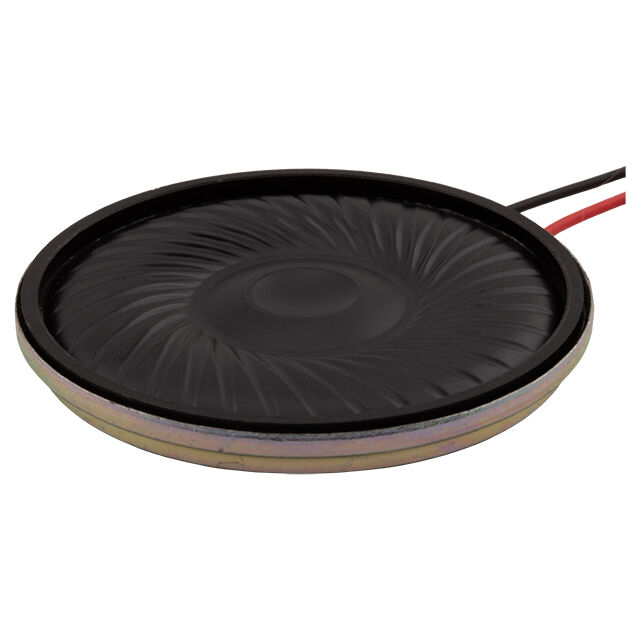{ width="250" }

    * $4.68/each
    * [link to product](https://www.digikey.com/en/products/detail/same-sky-formerly-cui-devices/CMS-4065-28L200/29566827?s=N4IgTCBcDaIMoAcCmBDA1kgTgZwAQGEBZOAWgBYAGANgFYSwAOAGTAopAF0BfIA)

    | Pros                                      | Cons                                                             |
    | ----------------------------------------- | ---------------------------------------------------------------- |
    | It comes with a lead wire for easy connection. | Its 40 mm diameter is the largest of the three, so it needs the most space inside the enclosure. |
    | Impedance 8Ω, rated input power 2W. |  The unit price of $4.68 is relatively high.               |

2. CMS-3652-28L200 speaker

    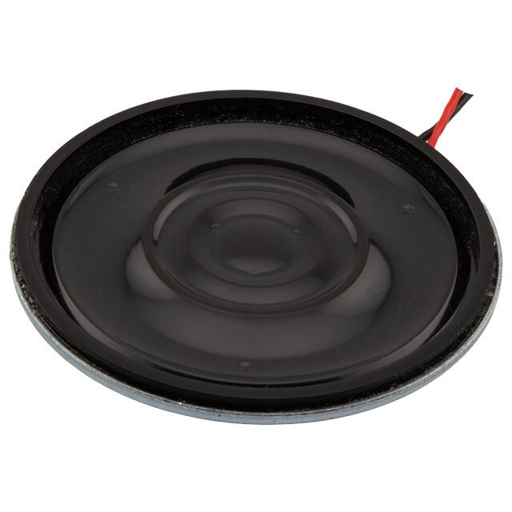{ width="250" }

    * $2.17 /each
    * [Link to product](https://www.digikey.com/en/products/detail/same-sky-formerly-cui-devices/CMS-3652-28L200/29778294?s=N4IgTCBcDaIMoAcCmBDA1kgTgZwAQGEBZOAWgGYA2AVjBLAA4AZMABhZAF0BfIA)

    | Pros                                                              | Cons                |
    | ----------------------------------------------------------------- | ------------------- |
    | Its 8 Ω impedance matches the planned speaker load.     | The nominal diameter is 36mm, and sufficient installation space needs to be reserved inside the casing.      |
    | Rated at 2 W, far above what the LM386 can deliver from a 5 V supply, so the speaker cannot be overdriven. | The manufacturer suggests using it in conjunction with the casing, but additional considerations need to be given to the fixed structure and acoustic design. |
    |  Nominal 36mm, with the lowest price at $2.17. |

3. CMS-36205-28L200 speaker

    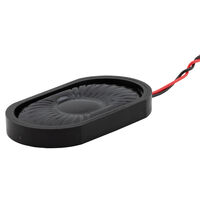{ width="250" }

    * $4.73/each
    * [Link to product](https://www.digikey.com/en/products/detail/same-sky-formerly-cui-devices/CMS-36205-28L200/28173784?s=N4IgTCBcDaIMIFkDKBaAzANjABgKwrAA4AZHbEAXQF8g)

    | Pros                                                              | Cons                |
    | ----------------------------------------------------------------- | ------------------- |
    | Its 36.2 × 20.5 mm oval shape fits a slim handle enclosure. | The maximum unit price is $4.73     |
    | Its 20.5 mm width fits narrow spaces where a 36–40 mm round speaker would not. | The oval housing requires a matching mounting bracket or enclosure opening. |
   
**Choice:** Option 2: CMS-3652-28L200 speaker

**Rationale:** I chose the CMS-3652-28L200 because it is low in price, compact in size and comes with leads, making it a suitable candidate as a speaker for the UI board. Its 8Ω impedance and 2W rated input power comply with the planned specifications to be adopted. Its 2 W rating is far above the roughly 0.3 W the LM386 can deliver from 5 V, so it cannot be overdriven, and it is the least expensive of the three. Subsequently, we will verify whether the prompt sound is clear and audible in conjunction with the actual power amplifier and the casing.

**LCD Display — [Individual subsystem: UI board]**

1. NHD-0216K1Z-FL-YBW LCD Display

    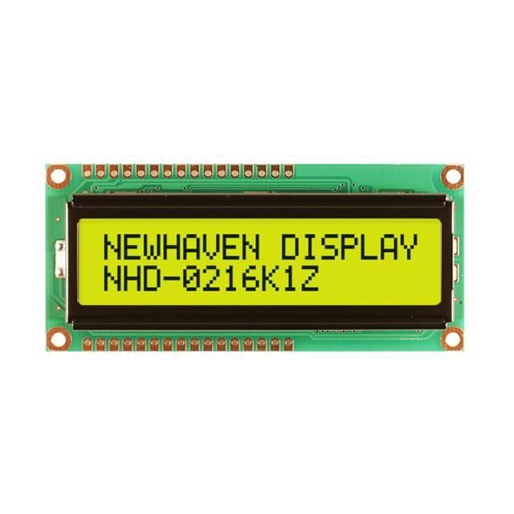{ width="250" }

    * $7.83/each
    * [link to product](https://www.digikey.com/en/products/detail/newhaven-display-intl/NHD-0216K1Z-FL-YBW/1701171?s=N4IgTCBcDaIHIAkAiBaADGAjANgNKYC0UAxAGRQE0AhAdRAF0BfIA)

    | Pros                                      | Cons                                                             |
    | ----------------------------------------- | ---------------------------------------------------------------- |
    | The 5V power supply complies with the power rail planned to be adopted by the UI board.    | The typical current of the backlight at 5V is 130mA, which needs to be included in the power supply budget. |
    | Semi-transparent reflective screens can display by using ambient light.   | When using a 4-bit write-only connection method, six GPIO signal lines are required.                                       |

2. NHD-0216K1Z-FSW-FBW-L LCD Display

    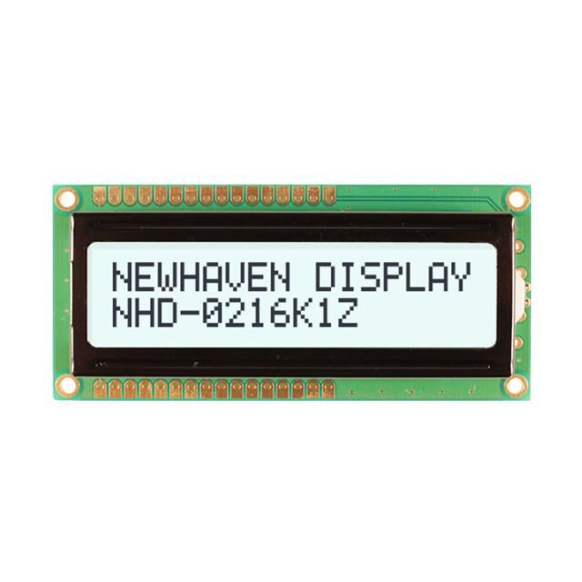{ width="250" }

    * $8.11/each
    * [Link to product](https://www.digikey.com/en/products/detail/newhaven-display-intl/NHD-0216K1Z-FSW-FBW-L/1701185?s=N4IgTCBcDaIHIAkAiBaADGAjANgNKYC0UAxAZQHUSAhSgGRAF0BfIA)

    | Pros                                                              | Cons                |
    | ----------------------------------------------------------------- | ------------------- |
    | The typical current of the backlight at 5V is only 15mA, which helps to control the power supply burden.      | The 16×2 character format limits the amount of information that can be displayed at one time.      |
    | The FSTN positive display screen features a light background with dark text, making it suitable for showing text readings.      | The V0 pin requires an external contrast voltage setting to add a regulating connection. |

3. NHD-0216K1Z-NSW-BBW-L LCD Display

    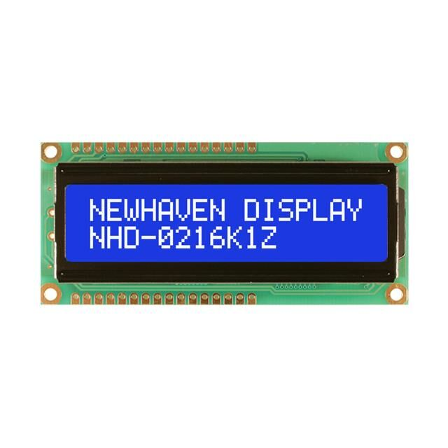{ width="250" }

    * $7.44/each
    * [Link to product](https://www.digikey.com/en/products/detail/newhaven-display-intl/NHD-0216K1Z-NSW-BBW-L/1701179?s=N4IgTCBcDaIHIAkAiBaADGAjANgNKYC0U4BlAdRQCFKKAZEAXQF8g)

    | Pros                                                              | Cons                |
    | ----------------------------------------------------------------- | ------------------- |
    | Supports 5V power supply and parallel interface.                                           | Transmissive screens rely on backlighting to obtain readable displays.    |
    | The white backlight makes it convenient to view the content in a darker environment.                                 | The character layout cannot present a complete graphical user interface.|
   
**Choice:** Option 2: NHD-0216K1Z-FSW-FBW-L LCD display

**Rationale:** I choose Option 2 because it conforms to the planned 5V power supply, parallel interface and 16×2 character format, with a typical backlight current of 15mA. Although the base price has increased by $0.28, the typical backlight current has been reduced from 130mA to 15mA, which helps to alleviate the power supply burden on the UI board. Because the LCD comes on its own small PCB, I will confirm with the instructor that it is not considered a daughter board before ordering.

**Low-Pass Filter Op Amp — [Individual subsystem: UI board]**

1. MCP6004-I/P quad op amp

    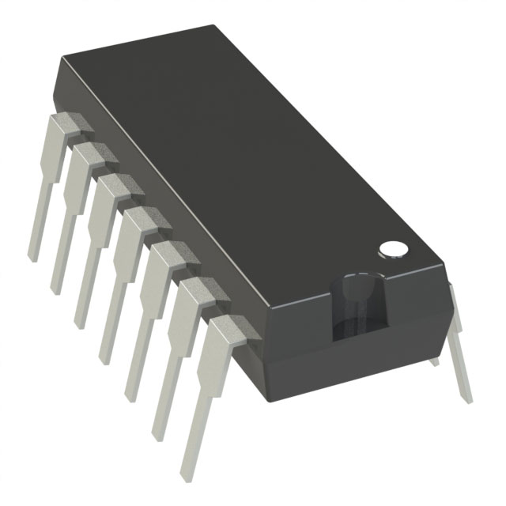{ width="250" }

    * $0.6/each
    * [link to product](https://www.digikey.com/en/products/detail/microchip-technology/MCP6004-I-P/523060?s=N4IgTCBcDaILIGEAKA2ADGgLAWgJIHokQBdAXyA)

    | Pros                                      | Cons                                                             |
    | ----------------------------------------- | ---------------------------------------------------------------- |
    | Rail-to-rail input and output on a 1.8–6.0 V supply, so it works on the 5 V rail and is issued in the class kit at no cost. | The 1 MHz gain-bandwidth product limits high-frequency, high-gain designs. |
    | DIP package simplifies breadboard prototyping                      | In the four-way operational amplifier structure, the unused channels need to be connected correctly.                                       |

2. MCP6024-I/P quad op amp

    { width="250" }

    * $2.73/each
    * [Link to product](https://www.digikey.com/en/products/detail/microchip-technology/MCP6024-I-P/417834?s=N4IgTCBcDaILIGEAKA2ADGALAWgJIHokQBdAXyA)

    | Pros                                                              | Cons                |
    | ----------------------------------------------------------------- | ------------------- |
    | A 10 MHz gain-bandwidth product provides design margin.                                            | Typical quiescent current is approximately 1 mA per channel.      |
    | DIP package allows easy assembly and replacement.                                | Unused channels occupy space and require proper termination.|

3. TLV9004IPWR quad op amp

    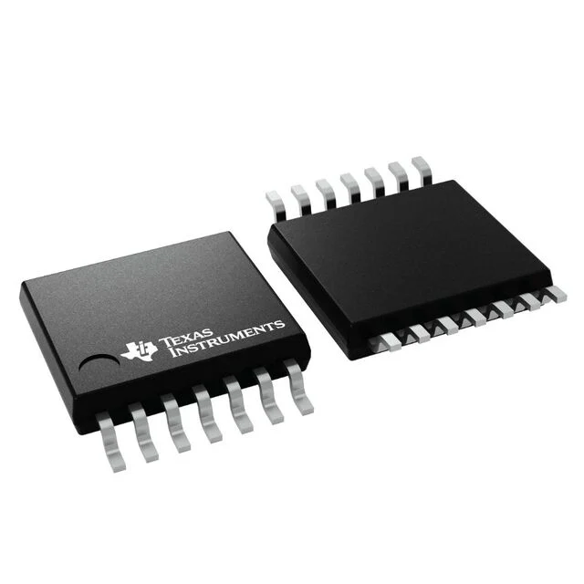{ width="250" }

    * $0.91/each
    * [Link to product](https://www.digikey.com/en/products/detail/texas-instruments/TLV9004IPWR/9674912?s=N4IgTCBcDaICoBkBqBOADGgLASQAoHUAlEAXQF8g)

    | Pros                                                              | Cons                |
    | ----------------------------------------------------------------- | ------------------- |
    | Rail-to-rail input and output from 1.8 V to 5.5 V, so it works on the 5 V rail. | Its TSSOP-14 package has a 0.65 mm pin pitch, finer than the 0.8 mm minimum of the Peralta PCB mill, so it cannot be used on our milled board (and it needs an adapter for breadboard testing). |
    |  The typical quiescent current per channel is approximately 60µA.                               | The maximum working power supply is 5.5V and it cannot be directly connected to a 9V power source. |
   
**Choice:** Option 1: MCP6004-I/P

**Rationale:** I choose MCP6004-I/P as the operational amplifier for the active low-pass filter. It supports 5V power supply for the system. The DIP packaging makes it convenient to build and debug on the breadboard, while remaining consistent with the existing block diagram. Its 1 MHz gain-bandwidth is far above the 4–5 kHz cutoff of the audio reconstruction filter, so the faster MCP6024 is not needed, and the TLV9004IPWR cannot be milled because of its 0.65 mm pin pitch. It is also issued in the class kit, so it costs nothing.

**Audio Power Amplifier — [Individual subsystem: UI board]**

1. LM386N-1/NOPB audio power amplifier

    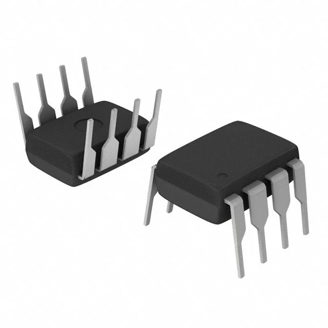{ width="250" }

    * $1.18/each
    * [link to product](https://www.digikey.com/en/products/detail/texas-instruments/LM386N-1-NOPB/6284?s=N4IgTCBcDaIDIFkDMAOAbAOQLQEYD0GA8gAoBCIAugL5A)

    | Pros                                      | Cons                                                             |
    | ----------------------------------------- | ---------------------------------------------------------------- |
    | Runs from 4–12 V, so it works directly on the board's 5 V rail and drives an 8 Ω speaker. | The output power is limited under low-voltage power supply, and the volume of the prompt tone needs to be verified. |
    | DIP packaging facilitates the construction of breadboards.      |  Conventional single-ended circuits require output coupling capacitors, which occupy additional space.                              |

2. LM4861M/NOPB audio power amplifier

    { width="250" }

    * $1.81/each
    * [Link to product](https://www.digikey.com/en/products/detail/texas-instruments/LM4861M-NOPB/334832?s=N4IgTCBcDaIDIFkAsAOAbARgQegHIHkAFAIRAF0BfIA)

    | Pros                                                              | Cons                |
    | ----------------------------------------------------------------- | ------------------- |
    |  Under the conditions of 5V, 8Ω and 1% THD+N, the typical output power is 1.1W.          | When SOIC packaging is used for breadboards, an adapter board is required.     |
    | Bridging output does not require an output coupling capacitor.                          | In bridge mode, both ends of the speaker must be connected to the amplifier output and cannot be grounded. |

3. LM4871M/NOPB audio power amplifier

    { width="250" }

    * $1.92/each
    * [Link to product](https://www.digikey.com/en/products/detail/texas-instruments/LM4871M-NOPB/364185?s=N4IgTCBcDaIDIFkAsAOA7ARgQegHIHkAFAIRAF0BfIA)

    | Pros                                                              | Cons                |
    | ----------------------------------------------------------------- | ------------------- |
    |  Supports 5V power supply and 8Ω speakers.          |  SOIC packaging requires an adapter board to be inserted into the breadboard.   |
    |  It provides an off mode to reduce power consumption when no sound is being played.                             | When the output power is high, it is necessary to check the heat dissipation of the chip and the power supply capacity of the power supply. |
   
**Choice:** Option 1: LM386N-1/NOPB audio power amplifier

**Rationale:** I chose the LM386N-1/NOPB as the power amplifier for the prompt sound circuit because it supports 5V power supply for the system and its DIP package makes it convenient for breadboard assembly and debugging. Its built-in voltage gain reduces the external gain setting components, making it suitable for the simple mono prompt sound function of this project.

**5V Voltage Regulator — [Individual subsystem: UI board]**

1. L7805ABV-DG 5V Voltage Regulator

    { width="250" }

    * $1.04/each (Mouser); issued in class, so it costs nothing from my budget
    * [ST L7805ABV-DG at Mouser](https://www.mouser.com/en/ProductDetail/STMicroelectronics/L7805ABV-DG?qs=WHlX%252B%252B9%2FRwBQWEBhrAcOaw%3D%3D)

    | Pros                                      | Cons                                                             |
    | ----------------------------------------- | ---------------------------------------------------------------- |
    | A fixed 5V output is required, and there is no need to set the resistor for the output voltage.          | The input and output voltage differences are converted into heat, and heat dissipation is required when there is a large current. |
    |  The TO-220 in-line package is easy TO assemble and comes with overheat and short-circuit protection.  | The dropout voltage is about 2 V, so the input must stay above 7 V; the 9 V adapter leaves 2 V of headroom. |

2. LM2940CT-5.0/NOPB 5V Voltage Regulator

    { width="250" }

    * $2/each
    * [Link to product](https://www.digikey.com/en/products/detail/texas-instruments/LM2940CT-5-0-NOPB/32575?s=N4IgTCBcDaIDIFkwE4AsAGAwgFQLQFYA6dAegDkB5ABQCEQBdAXyA)

    | Pros                                                              | Cons                |
    | ----------------------------------------------------------------- | ------------------- |
    | Fixed 5V output, supporting 1A output current, and heat dissipation conditions must be met.    | The output capacitance must be at least 22µF and must meet the ESR requirements.     |
    | At 1A, the typical dropout voltage is approximately 0.5V.   | Converting 9 V to 5 V still generates substantial heat.  |

3. R-78B5.0-1.0 5V Voltage Regulator

    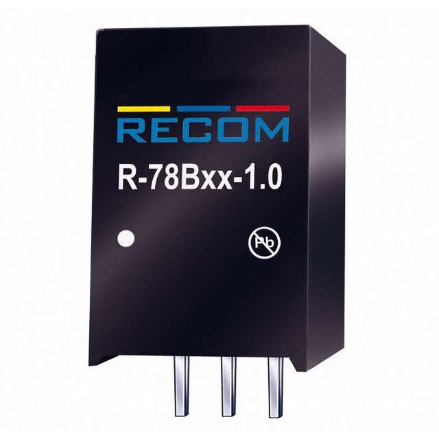{ width="250" }

    * $12.17/each
    * [Link to product](https://www.digikey.com/en/products/detail/recom-power/R-78B5-0-1-0/2256232)

    | Pros                                                              | Cons                |
    | ----------------------------------------------------------------- | ------------------- |
    | Supports 6.5-32V input and provides 5V, 1A output.              |  There are switching ripples and noise. Audio circuits need to pay attention to filtering and layout.   |
    | The switch has a high conversion efficiency and can reduce heat loss during the voltage reduction process.                 | The module has a minimum load recommendation. When the load is light, the output performance needs to be checked. |
    | | It is a switching module, but the course requires a through-hole linear regulator on every board, and at $12.17 it costs about ten times more. |
   
**Choice:** Option 1: L7805ABV-DG 5V Voltage Regulator

**Rationale:** I chose the L7805ABV-DG, the 5 V regulator issued in class and used on all three team boards, to convert the 9 V input to 5 V. It supplies up to 1.5 A, which covers the worst-case current of the UI board (the LCD, the LM386 driving the speaker, the op amp and the Curiosity Nano) with margin, and its 2 V dropout is satisfied by the 9 V adapter. It needs no voltage-setting resistors, the TO-220 through-hole package is easy to solder and can carry a small heatsink, and the built-in current limit and thermal shutdown protect the board. The LM2940CT-5.0 has a lower dropout but only a 1 A rating, and the R-78B5.0-1.0 is a switching module whose ripple could be heard through the audio path, while the course requires a linear regulator.

**9V AC/DC Power Adapter — [Individual subsystem: UI board]**

1. WSU090-1300 9V AC/DC Power Adapter 
    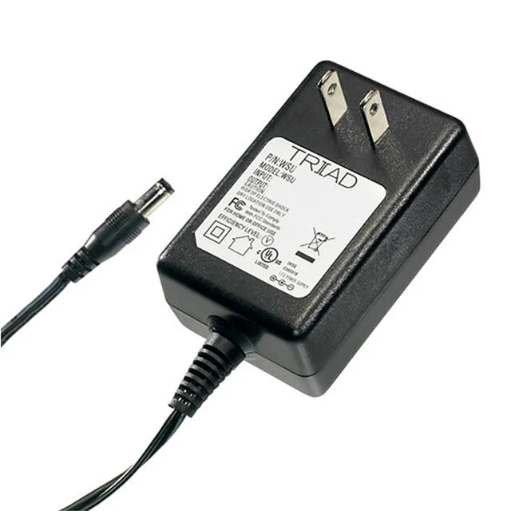{ width="250" }

    * $8.65/each
    * [link to product](https://www.digikey.com/en/products/detail/triad-magnetics/WSU090-1300/3094977)

    | Pros                                      | Cons                                                             |
    | ----------------------------------------- | ---------------------------------------------------------------- |
    | A 9V output is suitable for providing input to the L7805ABV-DG. |  The full-load operating temperature range is 0 to 40°C. |
    | The American-style plug can be directly inserted into the socket without the need for an additional AC power cord  | The output ripple and noise have a maximum peak-to-peak value of 150mV. The audio circuit needs to do a good job in power filtering.                          |
    | | Its 1.3 A output is less than the 1.5 A rating of the L7805ABV-DG, so it fails the power budget check that the source must supply the full regulator rating. |

2. GST18A09-P1J 9V AC/DC Power Adapter 
    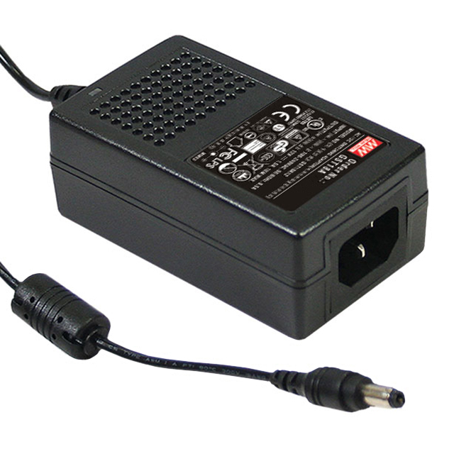{ width="250" }

    * $14.1/each
    * [Link to product](https://www.digikey.com/en/products/detail/mean-well-usa-inc/GST18A09-P1J/7703606?s=N4IgTCBcDaIOIGUAqBGAHAQQAwE4C0ACigFIgC6AvkA)

    | Pros                                                              | Cons                |
    | ----------------------------------------------------------------- | ------------------- |
    | It provides an output capacity of 9V and 2A.                                            | The AC power cord needs to be purchased separately.     |
    | The desktop structure allows the power supply body to be placed on the workbench.  | The 93 × 54 × 36mm casing requires additional space for placement. |

3. SWI12-9-N-P5 9V AC/DC Power Adapter 

    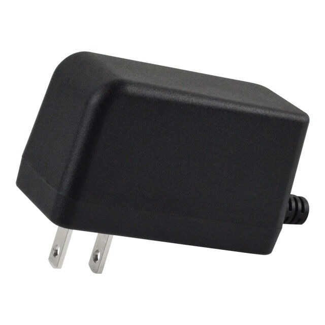{ width="250" }

    * $17.71/each
    * [Link to product](https://www.digikey.com/en/products/detail/bel-power-solutions/SWI12-9-N-P5/5287237)

    | Pros                                                              | Cons                |
    | ----------------------------------------------------------------- | ------------------- |
    | Supports 90-264VAC input.  | The output capacity is limited to 1.2A.     |
    | The no-load power consumption is up to 75mW, which can reduce the standby power consumption.           | Fixed American pins need to be converted into plugs in other standard socket areas. |
   
4. BestCH 9V 3A AC/DC Power Adapter (issued in class)

    { width="250" }

    * $4.52/each on Amazon (B09ZTKTLGW); issued in class, so it costs nothing from my budget
    * [BestCH 9 V 3 A adapter on Amazon](https://www.amazon.com/dp/B09ZTKTLGW)

    | Pros                                      | Cons                                                             |
    | ----------------------------------------- | ---------------------------------------------------------------- |
    | Its 3 A output covers the full 1.5 A rating of the L7805ABV-DG regulator with 1.5 A to spare. | There is no manufacturer datasheet, only the specifications in the store listing. |
    | It is already issued in class, so it costs nothing and is available now. | The plug inner diameter and polarity are not stated, so I must check the fit and the center-positive polarity with a multimeter before the first power-up. |
    | The 9 V output gives the L7805ABV-DG its required 2 V of dropout headroom without excess heat. | Amazon purchases are not reimbursable, so a replacement would come out of pocket. |

**Choice:** Option 4: BestCH 9V 3A AC/DC Power Adapter (issued in class), with the Mean Well GST18A09-P1J (Option 2) as the backup

**Rationale:** The power budget requires the external source to supply the full rating of every regulator connected to it, which is 1.5 A for the L7805ABV-DG. The BestCH adapter supplies 3 A, leaving 1.5 A to spare, and it is already issued in class at no cost. Its 9 V output gives the regulator its 2 V of dropout headroom while producing less heat than a 12 V supply. The Triad WSU090-1300 (1.3 A) and the SWI12-9-N-P5 (1.2 A) fail the power budget check, so the Mean Well GST18A09-P1J (2 A) is my backup if the class adapter fails its polarity and voltage checks. Because the BestCH adapter has no manufacturer datasheet, I will measure its polarity and no-load voltage before connecting the board.

## Microcontroller Pin Table

*Table: PIC18F57Q43 Curiosity Nano pin assignments on the UI board*

| MCU Pin | Function | Connected Component | Direction |
| --- | --- | --- | --- |
| RA2 | DAC1 audio output | Low-pass filter input (MCP6004) | Output |
| RE0 | LCD RS (register select) | LCD pin 4 | Output |
| RE1 | LCD E (enable) | LCD pin 6 | Output |
| RD4 | LCD data D4 | LCD pin 11 | Output |
| RD5 | LCD data D5 | LCD pin 12 | Output |
| RD6 | LCD data D6 | LCD pin 13 | Output |
| RD7 | LCD data D7 | LCD pin 14 (LCD R/W, pin 5, tied to GND) | Output |
| RD1 | START/STOP button input (weak pull-up) | START/STOP button to GND | Input |
| RD2 | UP button input (weak pull-up) | UP button to GND | Input |
| RD3 | DOWN button input (weak pull-up) | DOWN button to GND | Input |
| RC3 | UART receive (U1RX) | J1 pin 1, force sensing board UART TX | Input |
| RC2 | UART transmit (U1TX) | J1 pin 2, force sensing board UART RX | Output |
| RD0 | UI_RUN control signal | J1 pin 3, force sensing board | Output |
| RB0 | Debug LED (on PCB, planned) | LED + 1 kΩ resistor to GND | Output |
| RB3 | Debug button (on PCB, planned) | Pushbutton to GND | Input |
| RF3 / RB4 | On-board LED0 / SW0 | Built into the Curiosity Nano | — |
| RB6, RB7, MCLR | Programming and debugging (ICSP) | Reserved for the on-board debugger | — |
| RF0, RF1 | USB serial (CDC UART) | Reserved for the debugger's virtual COM port | — |
| VTG | Target power | +5 V rail from the L7805ABV-DG | Input |
| VOFF | Disables the Nano's own regulator | Tied to GND so the board is powered through VTG | Input |
| GND | Ground | Board ground, J1 pin 8 | — |

## Use of Generative AI

Generative AI (Claude) was used to review this page against the assignment requirements and to suggest corrections and wording for the pros, cons, rationale and pin table. I reviewed every change and the part choices before submission.

Query text:

1. [paste your first question exactly as you typed it]
2. [paste every other question, one per line]
