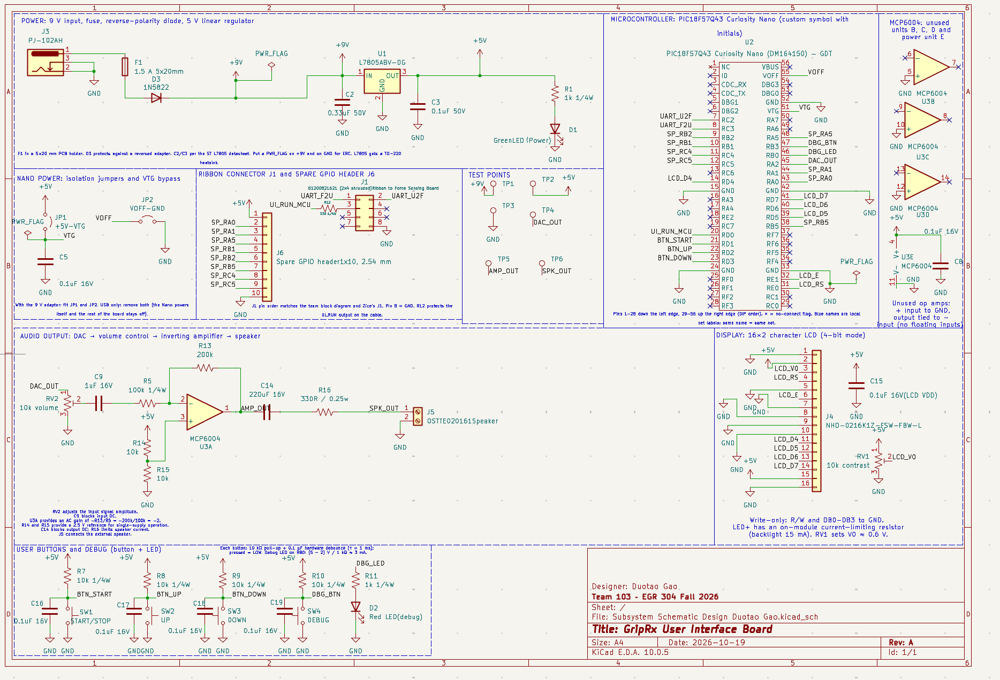

## Overview

This schematic shows the UI board for the GripRx project. It includes a 5 V power supply, a PIC18F57Q43 Curiosity Nano development board, an LCD, control buttons, and an audio output circuit with a low-pass filter and an amplifier. The board communicates with the force-sensing board through a UART interface. Debugging LEDs, test points, and spare headers are included to support testing and troubleshooting.

{style width:"350" height:"300;"}
**Figure ##:** Showing a example schematic.

## Resouces

The schematic as a PDF download is available [*here*](<Subsystem Schematic Design Duotao Gao.pdf>), and the Zip folder of the project [*here*](<Subsystem Schematic Design Duotao Gao.zip>).
