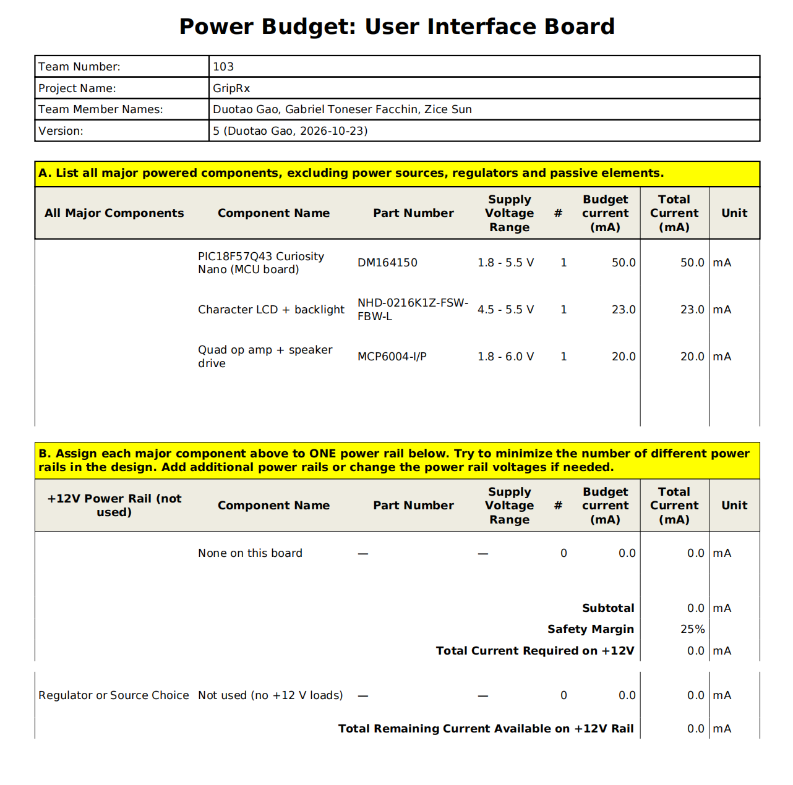
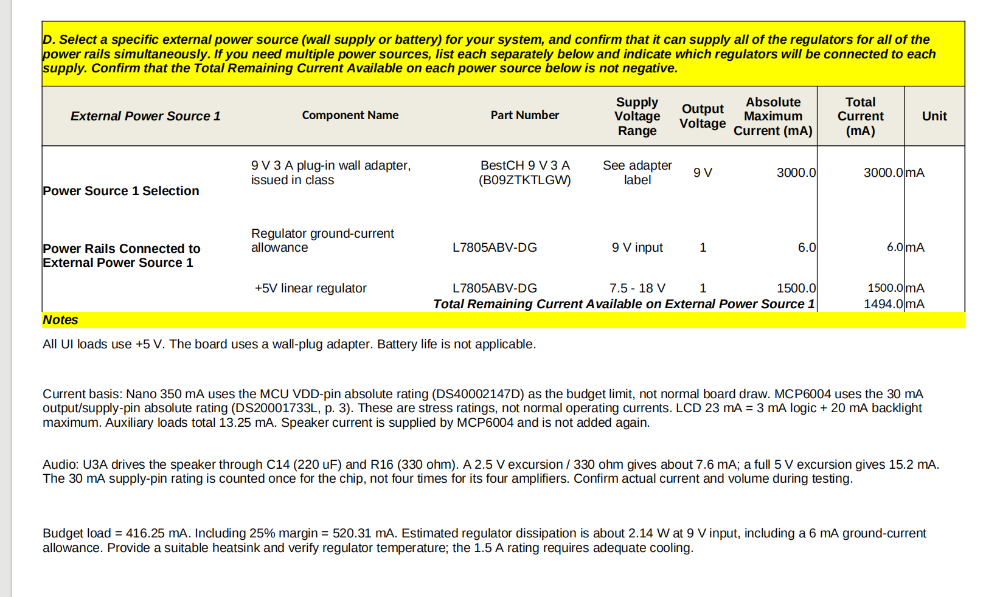

# Power Budget: UI (User Interface) Board

## Overview
The power consumption budget includes Curiosity Nano, LCD and its backlight, MCP6004 speaker driver circuit, LED, buttons, potentiometer and bias circuit. The 9V adapter provides a single + 5V power supply to the circuit board through the L7805ABV-DG regulator. The main components adopt the maximum current value in the data sheet, and the auxiliary load adopts the upper limit of the calculated current, with an additional 25% safety margin. The absolute maximum rated value of the pin has been clearly distinguished from the normal operating current.

{style width:"350" height:"300;"}

{style width:"350" height:"300;"}

## Conclusions

The total load current in the budget is 416.25 mA, and after adding a 25% safety margin, it becomes 520.31 mA. Under these budget assumptions and with adequate heat dissipation measures in place, the rated power supply capacity of the selected voltage regulators and adapters can meet the requirements. At a 9V input, the expected power loss of the voltage regulator is approximately 2.14W. Therefore, a suitable heat sink is required and its operating temperature should be verified. The actual current consumption and speaker performance will be verified in the prototype test. Since the circuit board is powered by a wall-plug adapter, battery life calculation is not applicable.

## Resources

The power budget as a PDF download is available [*here*](Duotao_Gao_Power_Budget.pdf), and a Microsoft Excel Sheet [*here*](Duotao_Gao_Power_Budget.xlsx).
