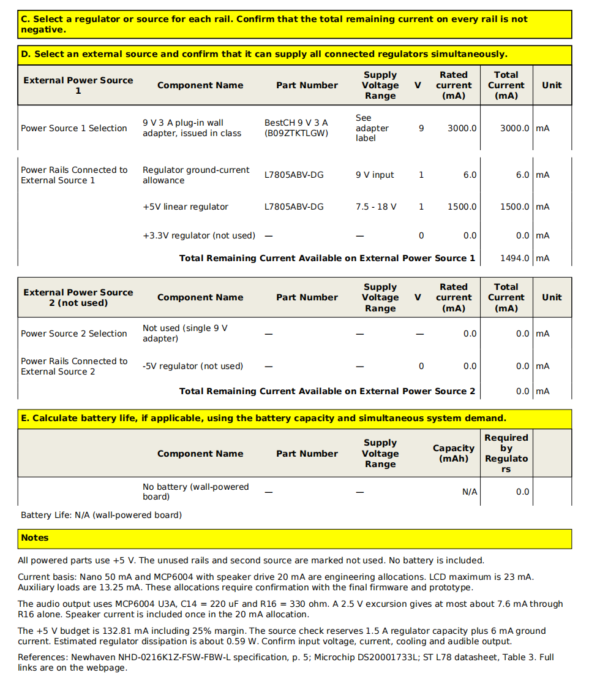

## Overview
The power supply budget includes Curiosity Nano, LCD and its backlight, MCP6004 speaker driver circuit, LED, buttons and bias circuit. The 9V adapter provides a 5V power supply through the L7805ABV-DG regulator. The budget assumes that all parts operate simultaneously and adds a 25% current safety margin. The design estimated value and the manufacturer's specification value have been indicated separately.

> Capture your power budge as a image to display. Take time to get clean breaks and a well organized layout.

{style width:"350" height:"300;"}

{style width:"350" height:"300;"}

{style width:"350" height:"300;"}

## Conclusions

The estimated total load current is 106.25 mA, and after adding a 25% safety margin, it becomes 132.81 mA. The rated power supply capacity of the selected voltage regulator and adapter can meet the estimated UI board load requirements. The actual power consumption, voltage regulator temperature and speaker performance will be verified in the prototype test. Since the system uses a wall-plug adapter, battery life calculation is not applicable.

## Resouces

The power budget as a PDF download is available [*here*](PowerBudgetExample.pdf), and a Microsoft Excel Sheet [*here*](PowerBudgetExample.xlsx).
