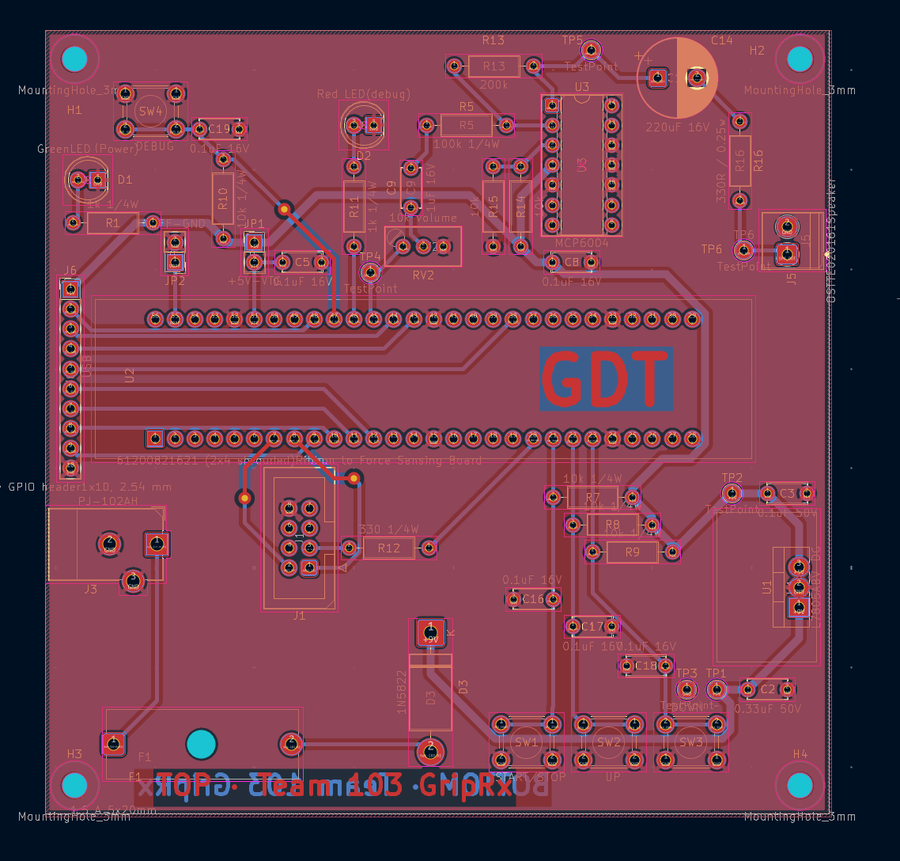
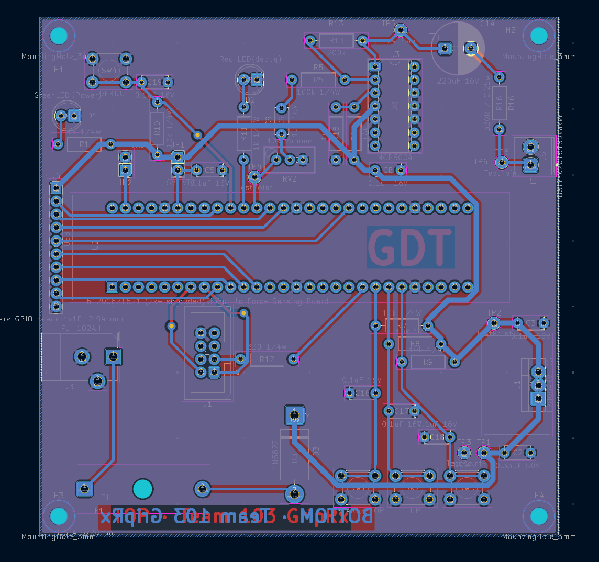

# PCB Design
**Duotao Gao · EGR 304 · Team 103 GripRx · User Interface Board**
[Team website](https://egr304-2026-f-103.github.io/) | [Individual home](../index.md)
## Overview
Two-layer, through-hole PCB for my subsystem, laid out in KiCad 10 and submitted to
Peralta Studios for milling on the LPKF ProtoMat S63.
| Item | Value |
| --- | --- |
| Board size | 100 mm x 100 mm (limit 100 mm x 100 mm) |
| Layers | 2 copper (top and bottom), no solder mask, no silkscreen |
| Copper | 0.5 oz/ft² |
| Traces | 40 mil power and ground (+9V, +5V, GND, VTG), 20 mil signal, 15 mil minimum |
| Clearance | 10 mil minimum |
| Vias | 1.6 mm pad, 0.8 mm hole |
| Ground | GND pour on both layers, stitched with vias |
| Footprint library | DG_Footprints (custom footprints prefixed DG_) |
| DRC | 0 errors |
## PCB Layout
### Top

### Bottom

## Files
- [PCB layout, top and bottom (PDF)](Duotao_PCB_Layout.pdf)
- [KiCad project (ZIP)](Duotao_PCB_Project.zip)
- [Gerber and drill files (ZIP)](DuotaoGao103.zip)
## Layout Notes
- The LCD is along the top edge and the four buttons are along the bottom edge.
- The Curiosity Nano is under the LCD connector, so the LCD data lines are short.
- J1 (ribbon to the force sensing board) is on the right edge.
- Through-hole connectors are routed on the bottom layer; vias are kept to a minimum and none are
under components.
